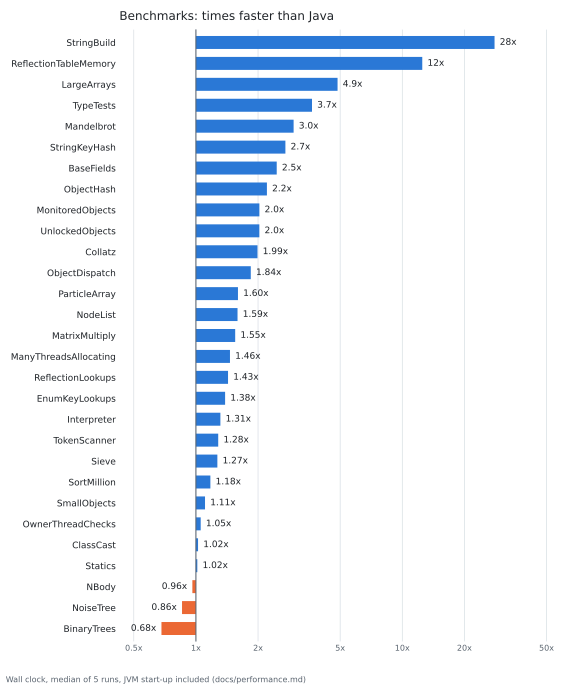
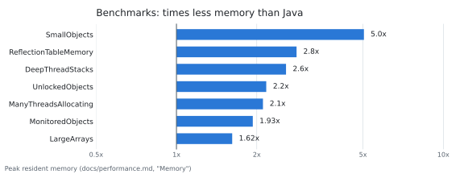
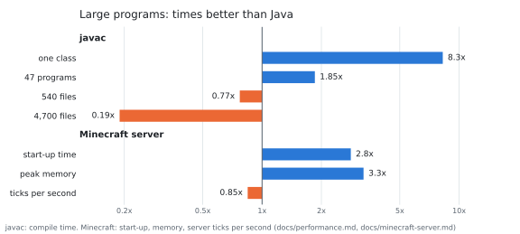

# java-to-rust

Translates whole Java programs into Rust programs with the exact same output, in minutes, on
one machine.

Porting a large codebase with AI agents means having a model read and rewrite every line: hours
of agent time, a token bill that grows with the code, and a review of everything it wrote. Even
then, the best models get fewer than half of real translations right in research benchmarks
([RustRepoTrans](https://arxiv.org/abs/2411.13990),
[a study of real-world code](https://arxiv.org/abs/2405.11514)). java-to-rust is a compiler instead: it costs
nothing per run, gives the same output every time, and is checked against the JVM.

| program | Java in | Rust out | translation | Rust build |
|---|---:|---:|---:|---:|
| javac, the Java compiler | 178,000 lines, plus the JDK code it uses | 951,000 lines | 65 s | under 3 min |
| Minecraft server 26.3 | 547,000 lines, plus its libraries and the JDK | 7.3 million lines | 6 min | 36 min |

Times on a 16-core laptop (Ryzen AI 7 350). The Rust build is a quick release build for javac
and an optimized release build split into 14 crates for the server.

The results run like the originals:

- **javac:** the translated compiler writes the same class files as the real one, byte for byte.
- **The Minecraft server** starts in under a second and uses a third of the JVM's memory.
- **The test suite:** over a thousand Java programs, each checked against the JVM's output.

## How it works

javac parses and type-checks the source, a set of program analyses works out what each value can
and cannot do, and a code generator writes Rust from those facts. Where the analyses prove it
safe, the output is plain Rust (owned structs, `Vec`, plain arithmetic, no null checks);
everywhere else it falls back to a faithful form that keeps Java's behaviour.

## Example

```java
public class Shapes {
    interface Shape { double area(); }
    record Circle(double r) implements Shape { public double area() { return Math.PI * r * r; } }
    record Square(double side) implements Shape { public double area() { return side * side; } }

    public static void main(String[] args) {
        Shape[] shapes = { new Circle(1.5), new Square(2) };
        double total = 0;
        for (Shape s : shapes) total += s.area();
        System.out.printf("total area: %.2f%n", total);
    }
}
```

becomes (abridged):

```rust
struct ShapesCircle {
    r: f64,
}

impl ShapesCircle {
    fn area(&self) -> f64 {
        3.141592653589793 * self.r * self.r
    }
}

fn main() {
    let shapes: Vec<ShapesShape> = vec![
        ShapesShape(java::Thin::pointer::<Arc<ShapesCircle>>(2, Arc::new(ShapesCircle__new(1.5)))),
        ShapesShape(java::Thin::pointer::<Arc<ShapesSquare>>(3, Arc::new(ShapesSquare__new(2.0)))),
    ];
    let mut total = 0.0;
    for s in shapes.iter().cloned() {
        total += ShapesShape__area(s);
    }
    java::print_format(java::wtf8("total area: %.2f%n"), &[java::Arg::Double(total)]);
}
```

What Rust lacks (Java's number formatting, strings, threads and monitors, a garbage collector,
the JDK's native methods) comes from the runtime crate in `crates/runtime`.

## Performance

Each bar shows how many times better the translation is than Java on the same machine: to the
right (blue) it wins, to the left (orange) it loses. Small programs win clearly, partly because
there is no JVM to start. On long-running work the JVM's just-in-time compiler is still ahead:
the translated javac is slower on large inputs, and the translated Minecraft server runs at
about 85% of the JVM's tick rate while starting 2.8 times faster in a third of the memory.

<picture>
  <source media="(prefers-color-scheme: dark)" srcset="docs/images/benchmarks-dark.svg">
  
</picture>

<picture>
  <source media="(prefers-color-scheme: dark)" srcset="docs/images/memory-dark.svg">
  
</picture>

<picture>
  <source media="(prefers-color-scheme: dark)" srcset="docs/images/large-programs-dark.svg">
  
</picture>

The numbers, how they were measured and what makes the slow cases slow are in
[docs/performance.md](docs/performance.md).

## Build and run

You need a Rust toolchain and a JDK (21 or newer) with `javac` and `java` on `PATH`.

```bash
cargo run --release -p java-to-rust -- Program.java              # print the translation
cargo run --release -p java-to-rust -- Program.java --crate out/ # write a Cargo project
cd out && cargo run --release
```

Larger programs are translated whole, together with the JDK's own library sources. `--jdk`
finds them in your JDK (its `lib/src.zip`) and adds only the modules the program uses; your
libraries' sources go in with `--library`:

```bash
cargo run --release -p java-to-rust -- --main com.example.Main --source src/ --jdk --crate out/
```

A Maven or Gradle project can be given as it is; its build tool resolves the dependencies,
whose sources jars go in with the program. Libraries often reach code the translator rejects;
`--census` builds the program anyway, and `--approximate-messages` lets exception messages differ
from the JVM's ([docs/usage.md](docs/usage.md)):

```bash
cargo run --release -p java-to-rust -- --project my-app/ --census --approximate-messages --crate out/
```

The translator's binary is self-contained: `cargo install --path crates/translator` puts it on
your `PATH`, and it runs from anywhere while this checkout stays where it is (translated projects
build against its `crates/runtime`).

All options are in [docs/usage.md](docs/usage.md).

## Test

```bash
scripts/check.sh
```

Every test program is run on Java and, translated, as Rust; output and exit code must match
exactly. Java's output is the expected result, so no expectations are written by hand. See
[docs/testing.md](docs/testing.md) for the test layout, the fuzzer and the benchmarks.

## Documentation

- [What Java is supported](docs/supported-java.md), per language and library area
- [Architecture](docs/architecture.md): the pipeline and each stage
- [Object model](docs/object-model.md), [closures and nested classes](docs/closures-and-nested-classes.md),
  [exceptions](docs/exceptions.md), [threads](docs/multi-threading.md),
  [the garbage collector](docs/collector.md)
- [Performance](docs/performance.md) against the JVM
- [Plans](docs/native-speed.md) for faster output, [a thorough mode](docs/thorough-mode.md) and
  [more natural Rust](docs/natural-rust.md)

Everything else is in [docs/](docs/).

## License

The translator is GPL-3.0-or-later ([LICENSE](LICENSE)). Everything it puts into a translated
program is MIT OR Apache-2.0: the runtime crate ([crates/runtime](crates/runtime)) and the
translator's own Java that gets translated along with the program
([crates/translator/java/LICENSE.md](crates/translator/java/LICENSE.md)). So translating a program
adds no license terms of the translator's to it. A whole-program translation also contains the
JDK's code, which keeps the JDK's license (GPL-2.0 with the Classpath Exception).
